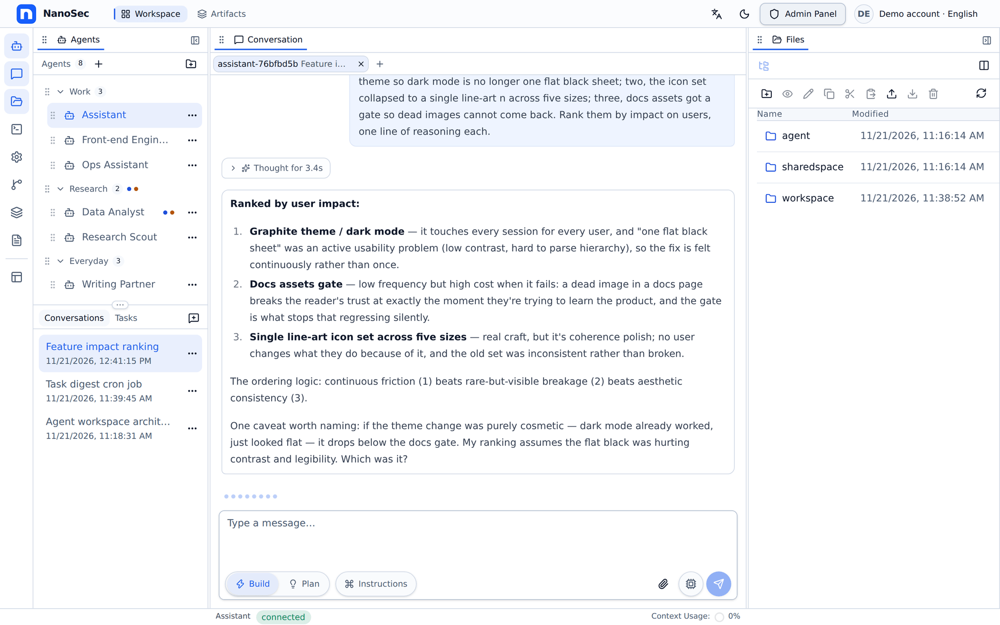
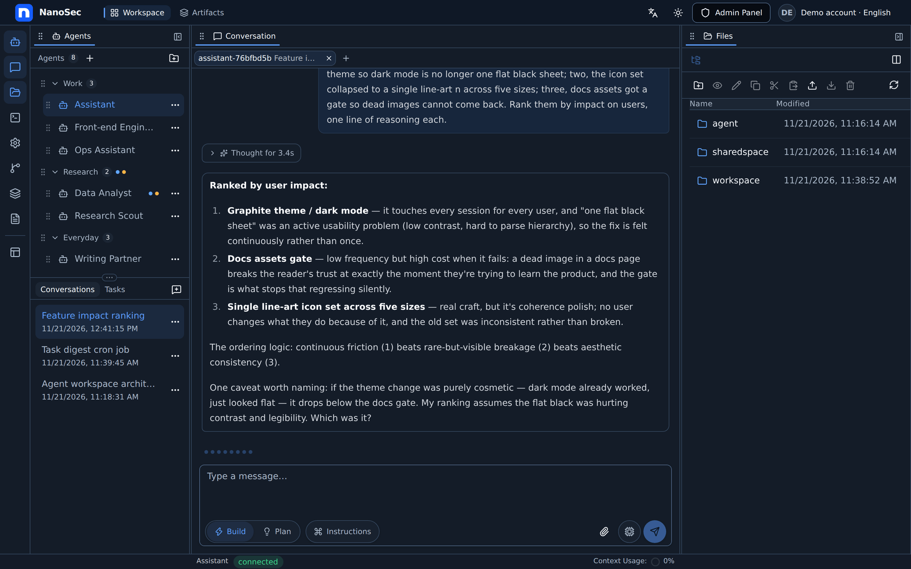
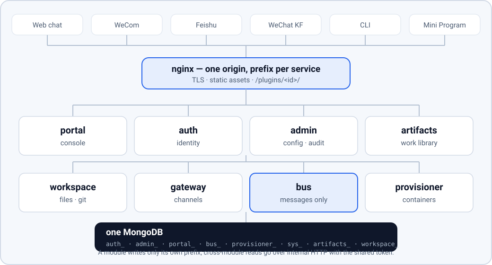
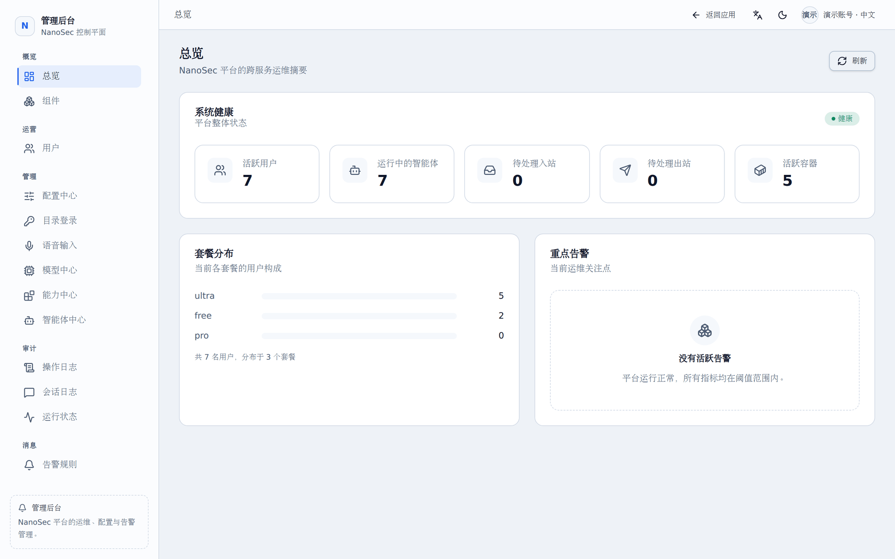
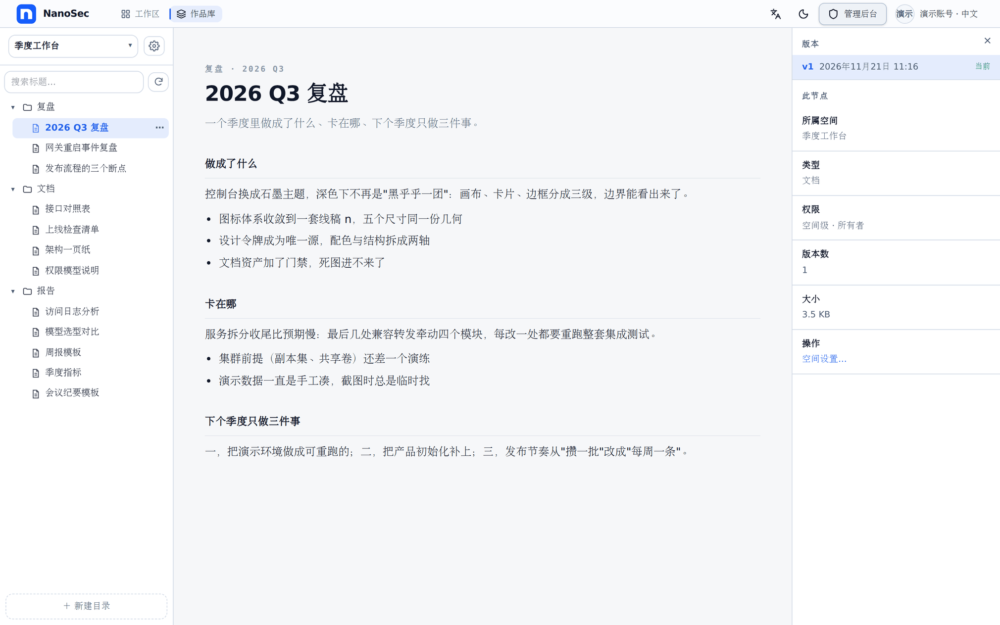

<p align="center">
  <picture>
    <source media="(prefers-color-scheme: dark)" srcset="docs/assets/lockup-dark.svg">
    
  </picture>
</p>

<p align="center">
  <strong>Self-hosted, multi-user AI assistant platform in Go</strong><br>
  one container per user, every channel, one MongoDB.
</p>

<p align="center">
  For teams and companies that run their own AI workspace on their own infrastructure.
</p>

<p align="center">
  English · <a href="./README.zh-CN.md">简体中文</a>
</p>

<p align="center">
  <a href="./LICENSE"></a>
  <a href="https://go.dev"></a>
  <a href="https://gitee.com/kobeyoung81/nanosec/releases"></a>
</p>

<p align="center">
  
</p>

<p align="center"><sub>The workbench: agents on the left, conversations below, the composer in the middle. Light theme, 1440 × 900.</sub></p>

<details>
<summary>Dark theme</summary>

<p align="center">
  
</p>

</details>

## What you get

- 💬 **One assistant, every channel.** Web chat, WeCom, Feishu, WeChat customer
  service, a CLI and a WeChat Mini Program all reach the same person and the same
  history.
- 👤 **One container per user.** Every account gets its own agent container with
  its own filesystem, quotas and tools — provisioned on Docker, Swarm or Kubernetes.
- 🛠 **It does the work, not just the talking.** Shell, file read/write, a git
  panel, web fetch and search, cron jobs and background sub-agents.
- 🧩 **Several agents per person.** Roles with their own prompt, model and tool
  belt; route a message to the right one and switch between them in the console.
- 🧠 **Sessions that survive.** The transcript is the container's JSONL file and
  stays the source of truth; the server keeps a rebuildable projection for the UI.
- 📚 **Skills and prompts ship with the platform.** Bundled, versioned and seeded
  into the catalogue — no per-install hand tuning.
- 🗄 **One MongoDB, one prefix per module.** `auth_ · admin_ · portal_ · bus_ ·
  provisioner_ · sys_ · artifacts_` — a module writes only its own prefix, and
  cross-module reads go over internal HTTP.
- 🔒 **Self-hosted by default.** No queue, no object store, no vendor SaaS — the
  only external dependency is the model API you point it at.

## Quick start

You need Docker with Compose v2 and a MongoDB 7+ deployment you can reach (a
single-node replica set is enough). The stack does not ship a database container.

```bash
git clone --recurse-submodules git@gitee.com:kobeyoung81/nanosec.git
cd nanosec && cp .env.example .env
# edit .env: NANOSEC_BUS_DATABASE_URI, NANOSEC_BUS_INTERNAL_TOKEN, NANOARTIFACTS_SESSION_SECRET
docker compose up -d
```

Then open **http://localhost:14403** and register. The first account of a fresh
installation becomes its administrator, gets a default agent and a container
request, so Chat works as soon as that container is up.

Two init containers run before the services: `admin-init` applies the manifests
and seeds the catalogues, `bus-init` applies the bus manifests. The agent image is
not started by `up` — the provisioner launches it per user — but you can build it
with `docker compose build nanosec`.

Ports on the host: `14403` console — the only one published beyond the loopback —
plus `14400` bus, `14401` auth, `14402` gateway and `14404` admin, which answer on
`127.0.0.1` for operators and probes.

## How it works

<p align="center">
  
</p>

Three rules hold the split together:

1. **The bus carries messages.** Inbound and outbound queues, the event stream,
   and the tunnel paths to agent containers. Nothing else belongs there.
2. **One prefix per module.** Every collection is owned by exactly one service;
   anybody else reads it over that service's API.
3. **Services talk over internal HTTP** with the shared token — no shared package
   state, no second database.

## The console

<p align="center">
  
</p>

<p align="center"><sub>The admin console: health, users, containers, audit and alert rules — the operational half of the same shell.</sub></p>

<p align="center">
  
</p>

<p align="center"><sub>The work library: spaces and folders on the left, the published document rendered in place.</sub></p>

## Documentation

| Document | What it covers |
|---|---|
| [`docs/ARCHITECTURE.md`](./docs/ARCHITECTURE.md) | How the system is built today: services, data ownership, flows, security |
| [`docs/DEPLOYMENT.md`](./docs/DEPLOYMENT.md) | Compose, Swarm and Kubernetes; ports, environment, operations |
| [`docs/PRD.md`](./docs/PRD.md) | What the product is for and what it deliberately is not |
| [`docs/README.md`](./docs/README.md) | Index of every document in `docs/` |
| [`CONTRIBUTING.md`](./CONTRIBUTING.md) | Development setup, branches, commits, pull-request checks |

Each service submodule has its own `README.md` with its architecture, config keys
and CLI reference.

<details>
<summary>Environment variable prefixes</summary>

Environment variables carry connection-level settings only; operational settings
live in `admin_config` and are edited in the console (or with
`nanoadmin config set`).

| Service | Prefix | Examples |
|---|---|---|
| `nanobus` | `NANOSEC_BUS_` | `NANOSEC_BUS_DATABASE_URI`, `NANOSEC_BUS_INTERNAL_TOKEN`, `NANOSEC_BUS_ADMIN_BASE_URL`, `NANOSEC_BUS_PORTAL_BASE_URL`, `NANOSEC_BUS_PROVISIONER_BASE_URL` |
| `nanogateway` | `NANOSEC_GATEWAY_` | `NANOSEC_GATEWAY_BUS_URL`, `NANOSEC_ADMIN_URL`, `NANOSEC_PORTAL_URL` |
| `nanoagent` | `NANOSEC_` / `NANOSEC_AGENT_` | `NANOSEC_AGENT_BUS_URL`, `NANOSEC_ADMIN_URL`, `NANOSEC_PORTAL_URL` |
| `nanoprovisioner` | `NANOSEC_RUNNER_` / `NANOSEC_PROVISIONER_` | `NANOSEC_RUNNER_BUS_URL`, `NANOSEC_RUNNER_BACKEND`, `NANOSEC_PROVISIONER_MONGO_URI`, `NANOSEC_PROVISIONER_ADDR` |
| `nanoadmin` | `NANOSEC_ADMIN_` | `NANOSEC_ADMIN_MONGO_URI`, `NANOSEC_ADMIN_ADDR`, `NANOSEC_BUS_URL` |
| `nanoauth` | `NANOAUTH_` | `NANOAUTH_MONGO_URI`, `NANOAUTH_ADDR`, `NANOAUTH_JWT_KEY_ID`, `NANOAUTH_WECHAT_APP_ID` |
| `nanoportal` | `NANO_PORTAL_` / `NANOPORTAL_` | `NANO_PORTAL_BUS_URL`, `NANOPORTAL_MONGO_URI`, `NANOSEC_ADMIN_URL` |
| `nanoartifacts` | `NANOARTIFACTS_` | `NANOARTIFACTS_MONGO_URI`, `NANOARTIFACTS_SESSION_SECRET`, `NANOARTIFACTS_QUOTA_BYTES`, `NANOSEC_PORTAL_URL`, `NANOAUTH_INTERNAL_URL` |
| `nanoui` (backend) | `NANOUI_BACKEND_` | `NANOUI_BACKEND_ADDR` |

`NANOSEC_BUS_INTERNAL_TOKEN` is the platform-wide shared secret: every internal
surface (`/internal/v1/*`) answers only requests that carry it, and refuses when it
is unconfigured. `NANOSEC_ADMIN_URL` is where a service finds its own configuration.

</details>

## Status and roadmap

- **Released:** [`v0.1.0`](https://gitee.com/kobeyoung81/nanosec/releases) — the whole
  platform, with its ten images versioned together in `versions.lock`.
- **Working:** messaging across all channels, multiple agents per person, tools
  and skills, container provisioning on Docker / Swarm / Kubernetes, the admin
  console, and the work library.
- **In progress:** the service split is finishing — the last compatibility
  forwards off the bus, cluster prerequisites (replica set, shared volume),
  and the documentation catching up with the code.
- **Planned:** see [`docs/PRD.md`](./docs/PRD.md).

## Contributing

1. Read [`CONTRIBUTING.md`](./CONTRIBUTING.md) and install the hooks:
   `./scripts/install-hooks.sh`.
2. Branch from `master` as `feat/xxx` or `fix/xxx`.
3. Build and test every module you touched — the super-repo has no `go.mod`, so
   run the command inside each module directory: `cd nanoauth && go build ./...
   && go vet ./... && go test ./...`.
4. Open a pull request describing the change, how you verified it, and whether it
   touches `nanoprotocol` or a collection's shape.

Changes to `nanoprotocol` follow a fixed order: commit the protocol, run
`./scripts/bump-protocol.sh vX.Y.Z`, commit the bumped `go.mod`/`go.sum` in every
consumer, then push the submodules before the super-repo.

## Security

Please do not open a public issue for a vulnerability. Report it privately as
described in [`SECURITY.md`](./SECURITY.md); we acknowledge within three working
days.

## License

[AGPL-3.0](./LICENSE). The name and logo are covered separately — see
[`NOTICE`](./NOTICE).
